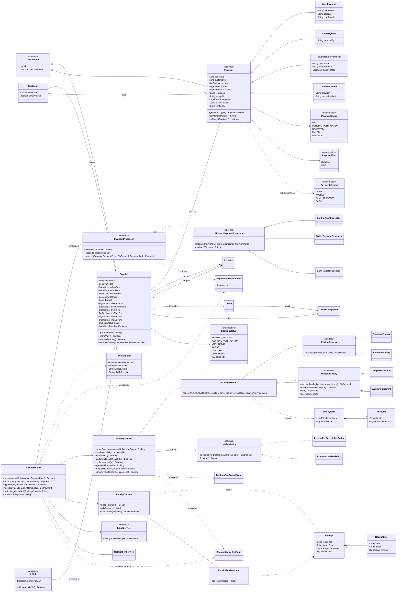
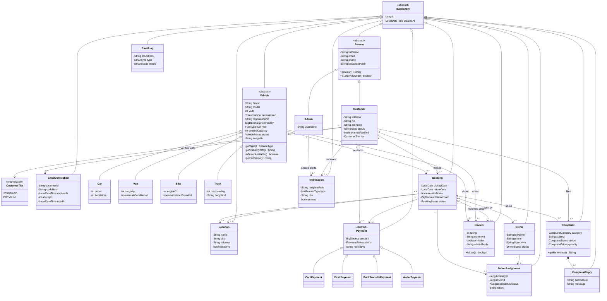
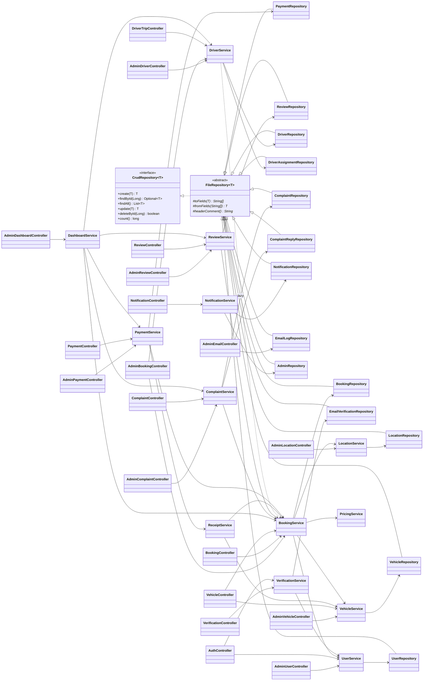
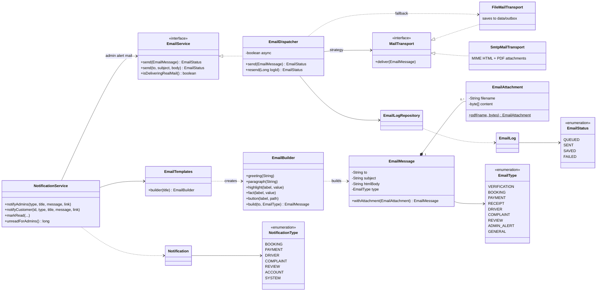
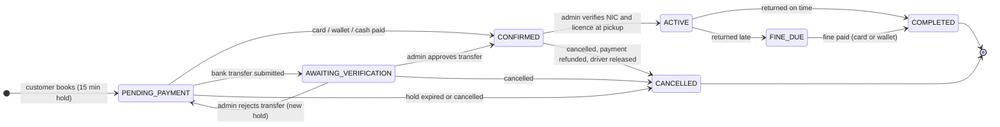
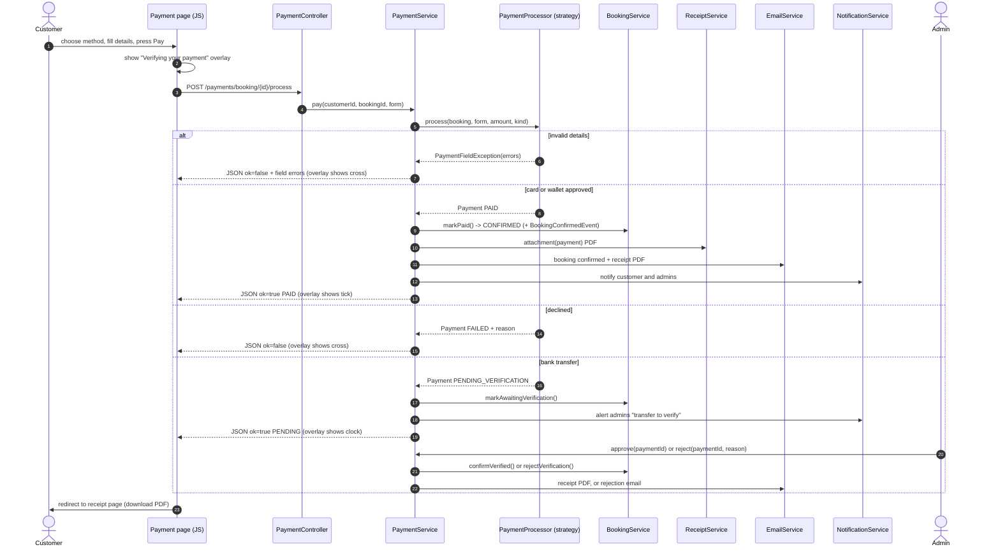
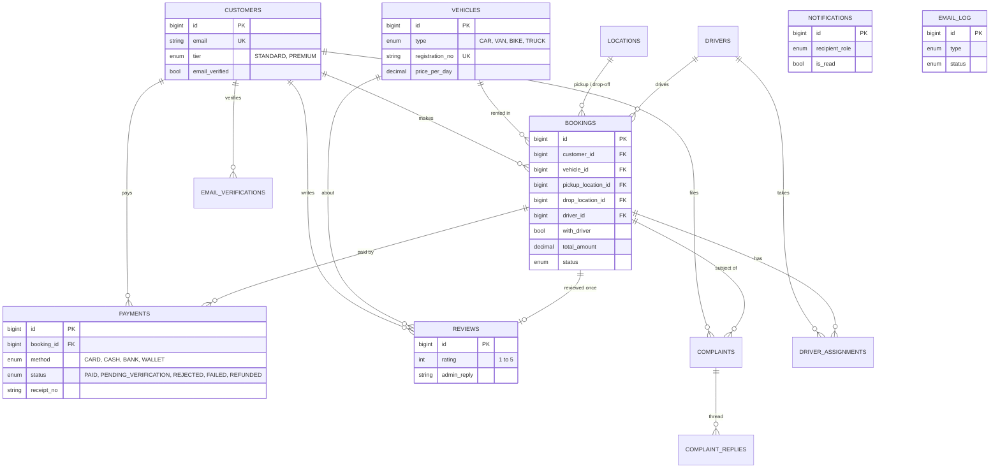

# Class diagrams, ER diagram and marking-guide mapping

Every diagram below is also saved as a ready-to-insert picture in `docs/diagrams/` (SVG for zooming, PNG for Word / PowerPoint).
The source of each is the `.mmd` file next to it - paste it into https://mermaid.live to edit.

| # | Diagram | Files |
|---|---------|-------|
| 1 | Payment and booking, with every relationship | `diagrams/01-payment-booking.svg / .png` |
| 2 | Complete domain model (all entities) | `diagrams/02-domain-model.svg / .png` |
| 3 | Layers: repositories, services, controllers | `diagrams/03-services-layers.svg / .png` |
| 4 | Email and notification classes | `diagrams/04-notification-email.svg / .png` |
| 5 | Booking life-cycle (states) | `diagrams/05-booking-states.svg / .png` |
| 6 | Payment sequence (what happens when you press Pay) | `diagrams/06-payment-sequence.svg / .png` |
| 7 | ER diagram (matches `database/database.sql`) | `diagrams/07-er.svg / .png` |

## 1. Payment and booking class diagram (all relationships)

Reading the arrows: hollow triangle = inheritance, dotted + hollow triangle = implements an interface,
filled diamond = composition (owns, cannot exist alone), hollow diamond = aggregation, plain arrow = association / uses,
dotted arrow = dependency (creates, throws, listens to).

## 2. Complete domain model

## 3. Layers

## 4. Email and notifications

## 5. Booking life-cycle

## 6. Payment sequence

## 7. ER diagram

## 8. Where each OOP concept is used (marking guide: 20 marks)

| Concept | Where |
|---------|-------|
| Encapsulation | Private fields with getters / setters in every entity; `Customer.setEmail` lower-cases, `Payment.setAmount` rejects negatives |
| Inheritance | `BaseEntity -> Person -> Customer / Admin`; `Vehicle -> Car / Van / Bike / Truck`; `Payment -> CardPayment / CashPayment / BankTransferPayment / WalletPayment`; `FileRepository<T> -> 14 repositories` |
| Polymorphism | `Vehicle.getCapacityInfo()` and `isDriverAvailable()`; `Payment.getMethodType()` / `getMethodDetails()`; `PricingStrategy`, `LateFeePolicy`, `PaymentProcessor`, `MailTransport` |
| Abstraction | `CrudRepository<T>`, `FileRepository<T>`, `EmailService`, `PaymentProcessor`, abstract `Vehicle`, `Payment`, `DiscountPolicy` |
| Strategy pattern | `PaymentProcessor` (card / wallet / bank), `PricingStrategy` (standard / premium), `LateFeePolicy` (per tier), `MailTransport` (file / SMTP) |
| Template Method | `DiscountPolicy.discountFor()` is final and calls the subclass hooks `isApplicable()` and `rate()`; `FileRepository` calls `toFields` / `fromFields` |
| Loose coupling (events) | `BookingConfirmedEvent` -> driver assignment; `BookingCancelledEvent` -> refund and driver release |

## 9. CRUD coverage (marking guide: 30 marks)

| Entity | Create | Read | Update | Delete |
|--------|--------|------|--------|--------|
| Customer | register + verify email | profile, admin list | edit profile, admin edit (tier, verified, block) | admin delete, own account delete |
| Vehicle (4 types) | admin form | catalogue, search, details | admin form | admin delete |
| Location | admin | admin list, booking drop-downs | admin | admin |
| Driver | admin | admin list | admin (on duty / off duty) | admin |
| Booking | booking form | my orders, admin list | change renter details, status changes | admin delete, customer cancel |
| Payment | pay online, admin cash | history, receipt, admin tabs | approve / reject transfer, refund | admin delete |
| Review | after a completed rental | public list, my reviews | edit, admin reply, hide | delete |
| Complaint | complaint form | my complaints, admin tabs | reply, status, priority, reopen | admin delete |
| Notification | automatic | bell list | mark read | trimmed automatically |

## 10. File handling (marking guide: 10 marks)

One text file per entity in `data/`, one record per line, `|` separated, special characters escaped. Writes go to a temp file and
are moved into place (never half written); reads come from a memory copy loaded once. New columns are appended at the end so old
files still load. Emails are saved in `data/outbox/` (with the PDF receipt) when SMTP is off, and every email is listed in `data/email_log.txt`.
